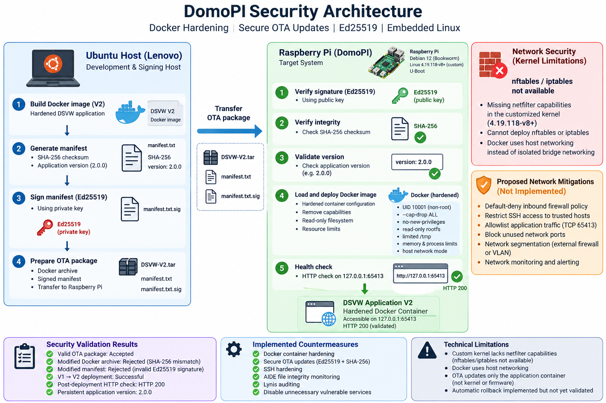

# DomoPi — Embedded Linux Security Hardening

**IoT Security | Embedded Linux | Docker Hardening | Secure OTA Updates | Ed25519**

## Overview

DomoPi is an intentionally vulnerable Raspberry Pi-based home automation system used in an authorized cybersecurity laboratory.

This project focuses on assessing and mitigating security weaknesses in a customized embedded Linux environment while preserving its original kernel (`4.19.118-v8+`) and U-Boot boot chain.

Two main security countermeasures were implemented:

1. **Docker Container Hardening** — reducing the privileges and attack surface of a vulnerable Python web application.
2. **Secure OTA Updates** — authenticating and verifying application updates using Ed25519 digital signatures and SHA-256 integrity checks.

Additional host security improvements include SSH hardening, Lynis auditing, AIDE file integrity monitoring, and disabling unnecessary vulnerable services.
A third countermeasure, network hardening using `nftables`/`iptables`, was investigated but could not be implemented due to missing netfilter capabilities in the customized Linux kernel. Alternative network security mitigations are proposed as future work.

## Security Architecture



## Technical Environment

| Component | Technology |
|---|---|
| Target | Raspberry Pi |
| OS | Debian/Raspbian 12 Bookworm |
| Kernel | Custom Linux `4.19.118-v8+` |
| Bootloader | U-Boot |
| Application | Damn Small Vulnerable Webserver (DSVW) |
| Containerization | Docker |
| OTA security | Ed25519, SHA-256 |
| Security auditing | Lynis |
| Integrity monitoring | AIDE |
| Development host | Ubuntu Linux |

## Initial Security Assessment

The initial assessment identified several security weaknesses:

- An unauthenticated root bind shell exposed on TCP port `64444`.
- A vulnerable Python web application running as root on TCP port `65412`.
- Excessive application privileges and unnecessary service exposure.
- Security limitations associated with the customized Linux kernel.

The operating system was migrated from Raspbian Buster 10 through Bullseye 11 to Bookworm 12, while preserving the original kernel and boot chain.

## Countermeasure 1 — Docker Container Hardening

The vulnerable DSVW application was migrated from a privileged systemd service to a hardened Docker container.

Security restrictions include:

- Non-root execution (`UID 10001`).
- Removal of Linux capabilities (`--cap-drop ALL`).
- Prevention of privilege escalation (`no-new-privileges`).
- Read-only root filesystem.
- Restricted temporary storage.
- Memory and process limits.
- Application accessible on 127.0.0.1:65413 during validation.

**Validation:** the hardened container remained operational and returned `HTTP 200` on `127.0.0.1:65413`.

See [Docker Hardening](docs/docker-hardening.md) for implementation details and validation tests.

## Countermeasure 2 — Secure Signed OTA Updates

A secure application-level OTA update mechanism was implemented to protect Docker image updates against unauthorized modifications.

### Architecture

```text
Ubuntu Host / Lenovo
    |
    | Prepare Docker V2 archive
    | Generate SHA-256 manifest
    | Sign manifest with Ed25519 private key
    |
    v
Raspberry Pi
    |
    | Verify Ed25519 signature
    | Verify SHA-256 integrity
    | Validate application version
    | Load Docker image
    | Deploy hardened V2 container
    | Perform HTTP health check
    |
    v
Application V2 — HTTP 200
```

The private signing key remains on the development machine. The Raspberry Pi uses the corresponding public key for verification.

### Security Validation

| Test | Observed result |
|---|---|
| Authentic OTA package | Accepted |
| Modified Docker archive | Rejected — SHA-256 mismatch |
| Modified signed manifest | Rejected — invalid Ed25519 signature |
| Authenticated V1 → V2 deployment | Successful |
| Post-deployment HTTP check | HTTP 200 |
| Persistent application version | `2.0.0` |

The deployment script also implements a rollback procedure, although recovery following a failed deployment has not yet been experimentally validated.

See [Secure OTA Updates](docs/secure-ota.md) for the cryptographic design, deployment workflow and test evidence.

## Additional Host Security Improvements

Host-level improvements were implemented alongside the two main countermeasures.

| Component | Result |
|---|---|
| Lynis | Hardening index improved from 60 to 64 |
| AIDE | File integrity monitoring configured and tested |
| SSH | Configuration hardened |
| Backdoor service | Disabled |
| Original DSVW service | Replaced by hardened Docker deployment |


## Countermeasure 3 — Network Hardening (Not Implemented — Kernel Limitations)
### Objective

The network hardening countermeasure was initially considered to reduce the network attack surface of DomoPi by restricting inbound connections and controlling access to exposed services.

The proposed implementation involved Linux firewall technologies, particularly `nftables` and `iptables`, to enforce network filtering rules.

### Identified Technical Constraint

DomoPi relies on a customized Linux kernel (`4.19.118-v8+`) that must be preserved as part of the laboratory environment.

During the implementation phase, the kernel was found to lack the necessary netfilter-related capabilities for the intended firewall configuration. Consequently, neither `nftables` nor `iptables` could be used to enforce the planned filtering rules.

The same kernel limitations also prevented standard Docker bridge networking, requiring the hardened application container to operate in `host` network mode.

### Proposed Security Mitigations

The following mitigations are recommended but have not been implemented or validated as part of this project:

| Proposed mitigation | Security objective |
|---|---|
| Default-deny inbound firewall policy | Block unauthorized incoming connections |
| Restrict SSH access to trusted administration hosts | Reduce remote administrative exposure |
| Allowlist application traffic on TCP port `65413` | Limit access to the DSVW application |
| Block unused and unnecessary network ports | Reduce the exposed attack surface |
| Network segmentation using an external firewall or VLAN | Isolate the Raspberry Pi from untrusted networks |
| Network traffic monitoring and alerting | Detect suspicious connections and scanning activity |

### Implementation Status

**Status: Not implemented — blocked by customized kernel limitations.**

No functional `nftables` or `iptables` firewall rules were deployed. The proposed network mitigations remain recommendations for future work.

A potential improvement would be to implement network filtering on an external gateway or firewall, without modifying the Raspberry Pi kernel.

## Technical Limitations

The original customized kernel lacks several networking capabilities required for standard Docker bridge networking and netfilter-based firewall rules.

As a result:

- Neither `nftables` nor `iptables` could be deployed due to missing netfilter-related kernel capabilities.
- Docker operates using host networking rather than isolated bridge networking.
- The OTA mechanism updates the application container, not the kernel or firmware.
- Automatic rollback is implemented but still requires dedicated failure-recovery testing.

These constraints were retained and documented to preserve the original embedded environment.

## Repository Structure

```text
DomoPI/
├── README.md
├── docker/
├── ota/
├── configs/
├── docs/
│   ├── initial-assessment.md
│   ├── docker-hardening.md
│   ├── secure-ota.md
│   └── security-limitations.md
├── evidence/
│   ├── docker/
│   ├── ota/
│   ├── lynis/
│   └── aide/
└── .gitignore
```

## Disclaimer

This project was conducted in an isolated and authorized educational laboratory using an intentionally vulnerable system.

All security testing and defensive experiments were performed for educational and research purposes.

---

**Focus:** Embedded Linux Security · IoT Security · Docker Hardening · Secure OTA · Cryptographic Verification
